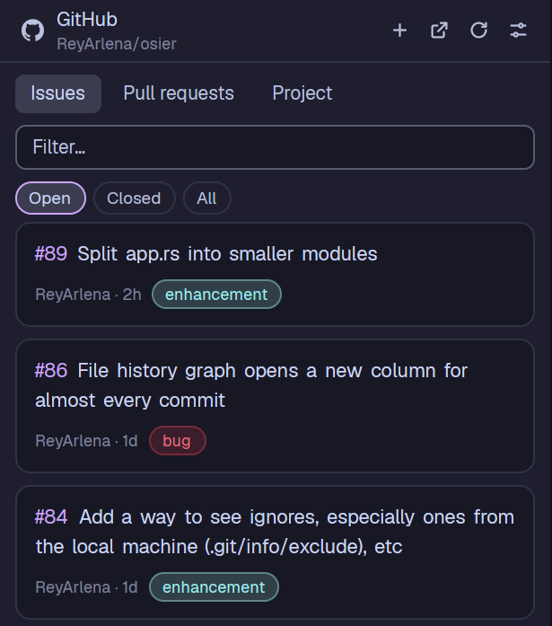

# GitHub: Pass Issues & PRs to Agent

A floating 480px panel (or a layout block, or a pane) that shows the GitHub issues, pull requests and project items of the repo the focused tab is working in. The list is a column of rounded cards: the `#number` in the accent colour leading the title, then a line with state, branch, author, age and label chips. Click a card to read the item (body, comments, a PR's branches and size), then press **Send to agent** to paste a prompt and a reference to it into the tab's agent, or **New agent tab** to start a fresh agent with it as its first task. It can also create issues and close them, including a close the agent prepared for you to review.



## What you see

Everything uses `theme()` colours, so it follows light and dark themes. Base text is 13px on `background`, in `foreground`.

**Header** (42px tall, 10px side padding, 4px gaps, 1px bottom border in `border`), left to right:
- In the list: the GitHub mark (`github.svg`, 15px, `muted`). In any other view: a back button (`chevron-left`).
- A two-line title block. Line 1, semibold, 16px line height: `GitHub`, `Issue #12`, `PR #12`, `Draft item`, `New issue` or `Settings`. Line 2, 11px, `dim`: the repo as `owner/repo`, or the folder (with `machine: ` in front for a remote space) when no repo was found.
- `Loading…` (11.5px, `dim`) while a read that is not a background refresh is running.
- Icon buttons (14px icon, 4px padding, 6px radius, `muted`, `hover` background and `foreground` on hover, each with a tooltip): **New issue** (`plus`, Issues tab only), **Open on GitHub** (`external`, when there is a page for the view), **Refresh** (`refresh`, list and detail), **Settings** (`settings`, list and detail), **Close** (`close`, only when it is a window).

**List view**, top to bottom:
- Tabs row: **Issues**, **Pull requests**, **Project**. Each 26px tall, 10px padding, 6px radius, 12.5px. The active one has `selected` background, `foreground` text and medium weight; the others `background` and `muted`.
- Filter box: 30px tall, 7px radius, 1px `input` border, `surface` background, placeholder `Filter…`. Words are matched (all of them, case-insensitive) against `#number`, title, author, status, repo, label names and assignees.
- State chips: Issues has Open, Closed, All. Pull requests has Open, Merged, Closed, All. Chips are 22px tall, 11px radius, 11.5px text; on: `accent` border, `selected` background, `foreground` text; off: `border` border, `background`, `muted`.
- The cards, in a scrolling column (10px side padding, 8px gap between cards).

**A card** (the `row()` function), one block with no divider:
- 12px side padding, 10px top, 11px bottom, 7px gap between its two rows. Rounded 10px, 1px `border`, `surface` fill, pointer cursor. On hover: `hover` fill and `input` border.
- Row 1: the reference then the title, as one line of 13px medium text (20px line height) that wraps. The reference is in `accent`, the title in `foreground`. It shows `#12` for an issue or PR, and in the Project tab `#12`, `other/repo#12` (an item from another repo) or `Draft`. gpui text has no coloured inline runs, so the row is an `h_flex().flex_wrap().items_center().gap_x(4)` holding the reference and then each word of the title as its own element.
- Row 2 (only if there is anything): 11px `dim`, 6px gaps, wrapping. In order:
  - A state badge, only when the item is not open or is a draft: `Closed` (`ansi1`), `Merged` (`ansi5`), `Draft` (`dim`). Badge: 18px tall, 6px sides, 9px radius, 10.5px medium, text in `background` on the state colour.
  - `branch · author · age`. The branch is the part of the row's `lead` after ` · ` (the list passes `#12 · branch-name` for PRs; the part before it leads the title). Age is like `now`, `5m`, `3h`, `2d`, `4mo`, `1y`.
  - Extra text: in the Project tab, assignees as `@name @name`.
  - Label chips, drawn like GitHub's dark labels: 20px tall, 8px sides, 10px radius, 11px medium. Fill is the label colour at 18% alpha (20% on a light theme), border at 40% (45%), as `#rrggbbaa`. Text is the label colour mixed toward white (dark theme) or black (light theme) in 5% steps until it reaches 4.5:1 contrast against the fill as it shows over `surface` (`labelLook()` in `ui.js`).
- The cards sit in a `v_flex` with 10px side padding and 8px gaps (8px top in Issues and PRs, 4px in Project, 10px bottom).

**Project tab** list:
- With more than one linked project, a row of chips to pick one.
- Status chips: **All**, then one per Status option of the project, each with a 7px dot in the option's colour (GRAY `dim`, BLUE `ansi4`, GREEN `ansi2`, YELLOW `ansi3`, ORANGE `ansi11`, RED `ansi1`, PINK `ansi13`, PURPLE `ansi5`). A `No status` chip is added when some items have none.
- Items grouped by status in the project's own option order. Each group has a header (11.5px semibold `muted`): an 8px dot, the status name and the count in `dim`. Then the cards.

**Detail view** (scrolling, 16px sides, 14px top, 10px gaps):
- For a project item: project icon, `Project title · Status` (11.5px `dim`).
- Title, 16px semibold.
- A meta line (11.5px `dim`): state badge (shown here for open items too, `Open` in `ansi2`), `owner/repo#12`, `author · opened 3d ago`, label chips.
- For a PR, once read: `head → base` in the terminal font, `+120` in `ansi2`, `−40` in `ansi1`, `5 files`, and the review decision in lower case (`changes requested`).
- The body as markdown at 13.5px (`_No description._` when empty), or `Reading…` until it arrives.
- `N comments` (12px semibold `muted`) and each comment in an 8px-radius bordered box with `author · 2h ago` and the markdown body.
- A bottom action bar (1px top border, 14px sides, 10px vertical, 8px gaps), two rows: **New agent tab**, **Open on GitHub** and, for an open issue, **Close issue**, sharing the width equally; under them **Send to <agent name>** (primary) across the full width. With no agent in the tab the primary reads `No agent in this tab` and is disabled.

**Buttons** (`pill`): 28px tall, 12px sides, 6px radius, 12.5px medium. Primary: `solid` background, `solid_foreground` text, 0.88 opacity on hover. Others: 1px `border`, `hover` background on hover. Disabled: 0.5 opacity, no click.

**New issue view**: `Title` input (32px), `Description` markdown textarea (grows 6 to 16 lines), `Labels (n)` as toggle chips with the label colour as the dot, and a bar with **Create issue** (primary, disabled without a title) and **Cancel**. Field boxes: 6px radius, 1px `input` border, `surface` background.

**Settings view**: **Auto refresh** chips (Off, 15s, 30s, 1m, 5m), then three prompt boxes (Issue prompt, Pull request prompt, Project item prompt), each with a hint and a **Reset** link that fills in the default. A bar with **Save** and **Cancel**.

**Close issue dialog** (a modal dialog, 440px wide): `Close issue #12`, a `dim` line `owner/repo · title`, **Reason** chips (Completed, Not planned), a **Comment** textarea (optional, markdown, grows 4 to 10 lines), `This issue is already closed.` in `blocked` when it is, any error in `ansi1`, and **Cancel** / **Close issue** at the bottom right.

**Problem box** (gh missing, not logged in, no scope, a failed read): 8px radius, 1px `blocked` border, `surface` background, an alert icon in `blocked`, the message, the command in a monospace box when there is one, and buttons: **Copy command** (copies it and shows a toast), **Install page** (when gh is missing, opens https://cli.github.com), **Check again** (or **Refresh** for a failed read). A command written in backticks inside an error message is picked up as the command.

Plain notes (12.5px `dim`, 16px padding) fill empty states: `Checking the GitHub CLI…`, `Looking for the repository…`, `Loading issues…`, `No issues here.`, `No issues match the filter.`, `No open GitHub Project is linked to this repository…`.

## How it behaves

**Which repo.** The focused terminal's folder (`focused().cwd`). If a mod pane or block has the focus, the tab's first terminal pane with a cwd, then the space's folder. `git rev-parse --show-toplevel` finds the root, `gh repo view --json nameWithOwner,url` the GitHub name (so `gh repo set-default` is honoured). Roots are cached per `machine|folder` and names per `machine|root` for the session. Only a different repo changes anything: moving between subfolders does nothing, and a non-repo folder in a tab that already showed a repo is ignored. A real repo change returns to the list (unless Settings is open).

**gh check first.** Each time it is shown, on the focused tab's machine: `gh --version`, then `gh auth status --active --hostname github.com` (falls back to no `--active` on old gh). It reads the token scopes from the output. Messages: not installed (install page), not logged in or expired (copy `gh auth login`), invalid `GH_TOKEN`, GitHub unreachable. The Project tab needs `read:project` or `project` in the scopes; without them it shows a box with `gh auth refresh -s read:project`. When gh lists no scopes (fine-grained or env tokens) it just tries.

**Reading.** Every read is cached under a key of what was asked, and errors are cached too (no retry loop until Refresh or Check again).
- Issues: `gh issue list -R owner/repo --state <open|closed|all> --limit 100 --json number,title,state,labels,author,updatedAt,url`.
- PRs: `gh pr list ... --state <open|merged|closed|all>` with `isDraft,headRefName` too.
- Detail: `gh issue view N -R repo --json ...` with body and comments; `gh pr view` adds `headRefName,baseRefName,additions,deletions,changedFiles,reviewDecision`.
- Labels (new issue form): `gh label list -R repo --limit 200`, sorted by name.
- Projects: `gh api graphql` for `repository.projectsV2(first:20)` (open ones only), then the project's `Status` field options and items, 100 a page, up to 3 pages (300 items). Drafts carry their body and creator; issues and PRs carry number, url, state, repo, up to 10 labels and 5 assignees.

**When it reads.** When it becomes visible and the last read is older than 10s; when the repo changes; when you pick a tab, state or project it has not read; on Refresh (always reads, and re-checks gh). **Auto refresh**: a 5s timer checks if the shown list or item is older than the chosen interval (default 30s; Off, 15, 30, 60, 300s) and reads it again. It only does this while the copy is on screen, gh is healthy and the view is the list or a detail. Background reads do not show `Loading…`, and a failed one keeps the old data.

**On screen** means: it is an overlay; or a pane of the active tab holds it; or a layout block holds it with no hidden ancestor and every stack showing its branch.

**Clicks.**
- A card opens its detail. Back (or Esc) returns to the list. Esc in the list closes the window.
- **Send to agent** runs `hc send <agent address> <text>` (paste then Enter) and then `pane.focus` on that agent, with a success toast. The agent is the tab's focused agent, else the one with the highest `seq`. If the send fails and the agent is `blocked`, the toast says to reply to it first.
- **New agent tab**: `knownAgents({ on })`, takes the first `installed` one and runs `tab.new` with `space`, `folder` (repo root), `argv: agent.run`, `task` (the prompt) and `name` (`#12` or `Draft`).
- **Create issue**: `gh issue create -R repo --title ... --body ... --label ...`, reads the number from the URL it prints, drops the cached issue lists and opens the new issue.
- **Close issue**: opens the dialog as a second copy of this mod (`openOverlay` with `kind: "dialog"`, `modal: true`, props `mode: "close-issue"`). Closing runs `gh issue close N -R repo --reason <completed|"not planned"> [--comment ...]`, shows a toast, sets shared state so every copy re-reads that repo, and closes the dialog.
- **Open on GitHub**: the item page; for a draft, `<project url>?pane=issue&itemId=<id>`. The header arrow opens `<repo>/issues`, `<repo>/pulls` or the project.

**What the agent gets.** The prompt from Settings, a blank line, then `owner/repo#12: Title` and the URL. Bodies are left out for issues and PRs (the agent reads them with gh). A project item gets `Project: Title (url)`, `Status: ...`, then `Issue: repo#n: title` and URL, `Pull request: ...`, or `Draft item: title` plus its full text. For an issue (also a project item that is an issue) in a local space, a close hint is appended telling the agent not to close it but to run:

```
sh '~/.config/herdr-app/mods/github-integration/close-issue.sh' owner/repo 123 <<'EOF'
<closing comment>
EOF
(add "not planned" after 123 if it won't be done)
```

(the real line uses `appHome()`). The default prompts ask the agent to investigate, ask before proceeding, and offer to close (issues), comment or merge (PRs), or move status (project items), keeping closing comments to `Fixed in <short SHA>.` plus one line.

**Close requests from agents.** `close-issue.sh <owner/repo> <number> [completed|"not planned"]` reads the comment on stdin and writes `close-<unix seconds>-<pid>.txt` (repo, number, reason, then the comment) into `~/.config/herdr-app/data/github-integration/inbox/` (`$HERDR_APP_HOME` if set). It writes a dot-file first and renames it, so the mod never reads half a file. It waits 2s for a running copy to take it, else runs `herdr-app do mod.open '{"name":"github-integration"}'` and waits 5s more. If still untaken it deletes the file, prints the direct `gh issue close` command and exits 1. Every main copy watches the inbox with `watchFolder`; the copy that manages to delete the file owns it. Requests older than 120s or with a bad repo or number are dropped. The dialog then looks up title and state with `gh issue view --json title,state,url`. Nothing is closed until the person presses Close issue.

**Settings** live in shared state under `github-integration.settings`: `tab`, `issueState`, `prState`, `projects` (chosen project id per repo), `hidden` (hidden status names per project id; Done is hidden by default), `poll` (seconds) and `prompts`. Only prompts that differ from the default (and from older defaults listed in `OLD_DEFAULT_PROMPTS`) are saved, so untouched prompts follow new defaults. The text filter is not saved. Every copy shares these.

**Shared change signal**: `github-integration.changed` holds `{ repo, at }`. Each copy compares `at` in `render` and drops cached reads for that repo and all projects.

## Built from

Files in `mods/github-integration/`:
- `mod.json`: `{ "place": "none", "title": "GitHub", "overlay": { "kind": "window", "width": 480, "height": 0.85, "key": "github-integration" } }`.
- `main.js`: the `View`. Views `list`, `detail`, `new`, `settings`, plus the close dialog mode when `props().mode === "close-issue"`.
- `github.js`: all `exec` calls (`gh`, `git`), the GraphQL queries, prompt builders, `ago()`, `matches()`.
- `ui.js`: `iconButton`, `pill`, `chip`, `labelChips`, `badge`, `note`, `stateLook`, `optionColor`, `problem`.
- `close-issue.sh`: POSIX sh helper for agents (above).
- `icons/`: 16px stroke SVGs with `currentColor` (alert, chevron-left, close, external, plus, project, refresh, settings) and the filled GitHub mark (github), drawn with `svg()` so they take the text colour.
- `keys.json` next to the folder: `{ "global": { "ctrl-shift-g": "mod.open:github-integration" } }`.

Imports: from `gpui-kit` `View`, `div`, `svg`; from `gpui-base` `v_flex`, `h_flex`, `Input`, `InputState`, `Textarea`, `TextareaState`, `TextView`; from `herdr` `agents`, `appHome`, `closeOverlay`, `exec`, `focused`, `hc`, `knownAgents`, `layout`, `notify`, `openOverlay`, `panes`, `props`, `readTextFile`, `run`, `settings`, `setShared`, `shared`, `spaces`, `theme`, `watchFolder`; and `fs/promises` (`mkdir`, `readdir`, `unlink`) for the inbox.

Commands it runs: `tab.new`, `pane.focus`. Every `exec` passes `on: space.machine` and `cwd` (the repo root), so remote spaces use gh and git on that machine.

Installers must tell people: it **runs programs** (`gh`, `git`, `hc send`), **reaches the network** through `gh` with the person's own login, and **reads and deletes files outside its folder** (the inbox under `~/.config/herdr-app/data/github-integration/`). It changes GitHub only when the person creates or closes an issue. It needs `gh` logged in (`gh auth login`), `read:project` for the Project tab (`gh auth refresh -s read:project`), and `git`; on a remote space, both on that machine.

## Watch out

- Stop `left` mouse-down propagation on every control (buttons, chips, cards, inputs). As a window, any press that is not stopped drags the window.
- Never keep a `cx`. The timer, spawns and clicks each pass their own.
- Cache by request key and have each read store under its own key. Then a slow answer for another repo or filter never lands in the wrong view.
- Keep error answers in the cache, or a failing read retries on every render. `recheck` clears the health entry and every cached error.
- Only re-resolve the repo when `machine|cwd` changes, and cache git and gh answers. Agents change folder often.
- `isShown()` must walk `layout()` (hidden nodes, stacks' `active` child, `floating`) and `panes()`; a copy in a hidden block keeps running and must not poll.
- `gh api graphql -f` sends strings as is. Use `-F` only for `after=null`, or a numeric string turns into a number.
- `gh auth status --active` does not exist before gh 2.40; retry without it on `unknown flag`.
- The close dialog is the same mod opened again with `mode: "close-issue"`; it must return early from `init` before starting the timer and inbox watcher.
- The close hint is left out for spaces on another machine: the script and the dialog only work on this computer. Inbox requests always use `on: null`.
- Releasing `InputState`/`TextareaState` when leaving the form or settings (`release()`) avoids leaking inputs.
- Limits: 100 issues, 100 PRs, 200 labels, 20 linked projects, 300 project items, 10 labels and 5 assignees per project item.
- `gpui-kit.d.ts` and `jsconfig.json` in the folder are written by the app; don't ship or edit them.
- Dialog height differs slightly: 400px from the detail page, 420px from an agent request.

## Done when

- `herdr-app check ~/.config/herdr-app/mods/github-integration` passes.
- `ctrl-shift-g` opens a 480px window at 85% height; pressing it again or Esc in the list closes it, and it reopens where it was dropped.
- With gh logged out, the panel shows the warning with `gh auth login` and **Copy command** copies it.
- Focusing a terminal inside a repo shows `owner/repo` under the title and lists its open issues as cards whose title starts with `#number` in `accent`, and author, age and label chips on the line below.
- A PR card starts with `#n` and has `branch · author · age` below; a merged PR in the Merged filter shows a purple `Merged` badge; open items show no badge.
- Typing in Filter narrows the cards; no match shows `No issues match the filter.`
- The Project tab shows status groups with counts, Done hidden at first, and the choice is remembered after reopening.
- Opening an issue shows its body and comments; **Send to agent** pastes the prompt and `owner/repo#n: title` and URL into the tab's agent and submits it.
- **New agent tab** opens a new tab named `#n` in the repo root with the agent running that prompt.
- Creating an issue with a label opens it afterwards and it shows up in the list.
- Running `sh close-issue.sh owner/repo 1 <<<'Fixed in abc1234.'` opens the Close issue dialog with the comment filled in, and Cancel leaves the issue open.
- With auto refresh at 15s, a change made on GitHub shows up in the visible list without pressing Refresh and without `Loading…` flashing.
