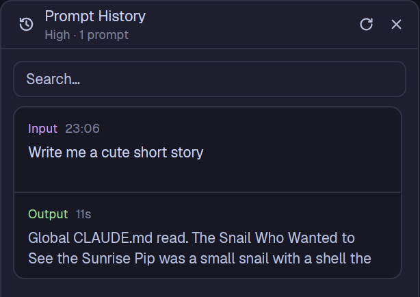

# Prompt History

A panel that shows every prompt you gave a Claude Code agent in its current session, and
what it answered, as a column of cards. The newest card sits at the bottom and the list
follows it like a terminal. Click a card to read the whole turn as markdown in the panel,
or open it in a dialog from the expand button that appears on hover.

## What you see

The panel fills its block, with 10px rounded corners, a 1px `border` outline and a
`background` fill, like the shipped Changes panel.

- **Header**, 42px, `border` line under it. A 15px history icon in `muted`, then two lines:
  "Prompt History" (semibold, 13px) and, in 11px `dim`, the agent's tab name and the
  prompt count ("Fix login · 7 prompts"). On the right: a ring spinner in `working` while
  the agent works, a refresh icon, a close icon. Icon buttons are 14px icons in `muted`,
  4px padding, 6px radius, `hover` background on hover.
- **Search box**, 32px tall, 8px radius, 1px `border`, placeholder "Search…", 10px from
  the panel edges.
- **Cards**, 152px tall each, 8px apart, 10px from the left edge and 14px from the right
  (room for the scrollbar). Each card: 10px radius, 1px `border` (`working` while that
  turn runs), `surface` fill, `hover` fill on hover. Two halves split by a 1px `border` line:
  - **Input**: "Input" in `accent` (11px, medium) and the prompt's time (HH:MM, `dim`),
    then the prompt as plain text, exactly two lines (18px line height, 12.5px).
  - **Output**: "Output" in `ansi2` (green), then either the duration and tool count
    ("1m 12s · 5 tools", `dim`; "Interrupted" in `blocked` when cut off), or a 11px spinner
    and "Working..." in `working`, pulsing opacity. Below, two lines of the answer in
    `muted` (or `dim` while it's still in progress).
- **Scrollbar**: a 4px rounded thumb in `border` along the right edge, only when the cards
  overflow.
- **Jump to present**: a 28px pill (`solid` fill, `solid_foreground` text, chevron-down
  icon, shadow) centred 14px above the bottom, only while scrolled up.

**Detail view** (in the panel after clicking a card, and in the dialog): the header shows a
back arrow, "Turn" and the time, plus an expand button. Below, two stacked cards, 12px
apart and 12px inset, each with a 3px colour band along its top that follows the rounded
corners (`accent` for Input, `ansi2` for Output):

- **Input** card: an 8px dot and "Input" in `accent`, the time in `dim`, a chevron. It
  starts collapsed to the same two-line preview; clicking its header expands the full
  prompt as markdown.
- **Output** card: "Output" in `ansi2`, duration and tools, then the whole answer as
  selectable markdown (13.5px). While working: spinner and "Working..." on the right, the
  text at 70% opacity, or "Waiting for the first words…".

**Install jq screen**: replaces the cards when `jq` is missing. Centred: a 44px rounded
badge reading "jq" in the terminal font and `accent`, "Install jq to use Prompt History",
one muted sentence on why, a bordered box with `sudo pacman -S jq`, `sudo apt install jq`
and `brew install jq` in the terminal font, and a "Check again" button.

Empty states, as 12.5px `dim` text: "No Claude Code agent in this tab.", "Looking for this
agent's session…", "Couldn't find this agent's Claude Code session.", "No prompts in this
session yet.", "No prompts match the search.".

## How it behaves

- **Which agent:** the Claude Code agent (`app === "claude-code"`) focused, else the
  newest one in the focused tab, else the one already shown, else the newest in the space,
  else the newest anywhere. Checked every 1.5s. Changing agent clears the panel and
  loads the new session.
- **Which session:** only the agent's current session. `/clear` or resuming another
  session in the same terminal starts the cards over (re-checked every 6s).
- **Live updates:** the transcript's folder is watched; every change reloads the turns.
  A turn is "Working..." while it has no end record and the agent's status is `working`
  or `blocked`. Mid-turn, the Output shows Claude's latest text; once done, the text it
  ended on (after its last tool call).
- **Scrolling:** the mouse wheel scrolls. At the bottom the list sticks there and follows
  new cards. Scrolling up lets go and shows "Jump to present", which scrolls back down and
  sticks again.
- **Card clicks:** a click opens the turn in the panel. Hovering shows a 14px expand button
  in a small `popover` box at the card's top right (6px in); it opens the turn in a dialog
  (70% wide, 85% tall) that keeps updating while the turn runs.
- **Keys:** Escape in the search box clears it (only when it has text). Escape in the
  detail view goes back to the cards. Esc closes the dialog.
- **Refresh:** re-finds the session and reloads it. The icon spins for at least 700ms.
- **Close:** inside a stack of panels it hides the panel column (as a tab-bar panel
  button does); as a window it closes the window; as a lone block it hides that block.
- **Search** filters by prompt or answer text, case-insensitive.
- `ctrl-shift-y` (from `keys.json`) toggles it as a window.

## Built from

- `mods/prompt-history/mod.json`: `{ "place": "none", "title": "Prompt History",
  "overlay": { "kind": "window", "width": 420, "height": 0.85, "key": "prompt-history" } }`.
  Put it in a layout as a block (`{ "mod": "prompt-history" }`), for example in a panel
  stack beside Files and Changes, or open it with `mod.open`.
- `main.js`: one `View`. With `props().overlay` and `props().turn` it is the dialog
  (props `{ file, turn, address }`); otherwise the panel.
- `transcript.js`: finding and parsing the transcript.
  1. `hc get <terminal> --json` gives `foreground.pid`, the running `claude`.
  2. `~/.claude/sessions/<pid>.json` gives `sessionId` and `cwd`. If that file is missing,
     the pid is a launcher: try its children (`pgrep -P <pid>`), up to 3 levels.
  3. The transcript is `~/.claude/projects/<cwd with every non-alphanumeric character
     replaced by "-">/<sessionId>.jsonl`; if not there, `find ~/.claude/projects
     -maxdepth 2 -name <sessionId>.jsonl`.
  4. `jq -c` cuts each record down to what the cards need: human prompts (`type: "user"`,
     `origin.kind: "human"`, not `isMeta`, not `isSidechain`; text blocks, images as a
     marker), assistant text and tool-use markers, and `system` records with subtype
     `turn_duration` (the turn's end, with `durationMs`).
  5. A turn starts at a human prompt and ends at `turn_duration`. Assistant text after
     the last `tool_use` is the answer. A new prompt before the end marks the previous
     turn interrupted.
- `herdr` functions: `agents`, `focused`, `exec`, `readTextFile`, `home`, `watchFolder`,
  `openOverlay`, `closeOverlay`, `layout`, `run("layout.hide")`, `props`, `settings`
  (terminal font), `theme`.
- Programs: `hc`, `jq` (needed), `grep` (fallback), `pgrep`, `find`, `test`. It reads
  `~/.claude/sessions/` and `~/.claude/projects/` (Claude Code's own files). No network.
- Art: 16px stroke icons in `icons/`: `history`, `refresh`, `close`, `expand`,
  `chevron-left`, `chevron-down`, `chevron-right`, `spinner` (a ring with one bright arc).
- Animation is native only: `svg(...).spin(ms)` and `.loop("opacity", ...)`, never a
  redraw timer.

## Watch out

- **Never call a scroll method from inside a `v_virtual_list` or `list` render callback.**
  The list holds its scroll state during layout and herdr-app panics ("RefCell already
  mutably borrowed") and keeps crashing on every start until the mod is removed.
- gpui's plain scroll areas can't be scrolled from a mod, and virtual-list rows can't
  have their own handlers (no hover button). So the card list scrolls by hand: a clipped
  area, cards absolutely placed at `top = 8 + index * 160 - offset`, only the visible
  ones drawn, the offset driven by `on_scroll_wheel` (positive `delta.y` scrolls up)
  and the area's height from `on_size_change`. That needs every card the same height.
- `exec` output is capped well under a long session's transcript (10 MB and more, mostly
  tool output and images), so the newest turns go missing. That's why `jq` is required
  and the panel refuses to run without it. When `jq` exits non-zero because Claude Code is
  mid-write on the last line, use what it printed before that.
- Claude Code rewrites `~/.claude/sessions/<pid>.json` often. One failed read isn't a lost
  session: keep the cards unless three reads in a row fail, or the panel flashes empty.
- gpui clips children to a rectangle, not to rounded corners. A full-width colour strip
  inside a rounded card pokes past its corners: make the card's own background the colour
  and inset the content 3px from the top instead.
- A flex column with `flex_col_reverse` does not start scrolled to the bottom in gpui.
- Only Claude Code on this machine. Other agents' transcripts aren't read, and remote
  machines aren't supported.

## Done when

- `herdr-app check ~/.config/herdr-app/mods/prompt-history` passes.
- With a Claude Code agent in the focused tab, the cards match its prompts, newest at the
  bottom, and the panel opens scrolled to the bottom.
- Sending the agent a prompt adds a card with "Working..." that turns into "Output" with
  a duration when Claude finishes, without the list flashing.
- Scrolling up shows "Jump to present"; pressing it scrolls back down and hides it.
- Hovering a card shows the expand button; it opens a dialog with Input and Output cards.
  Clicking a card body opens the same in the panel; Escape goes back.
- The Input card in the detail view starts collapsed and expands on click.
- With `jq` off the `PATH`, the install screen shows; "Check again" finds it once installed.
- Escape in a non-empty search box clears it.
